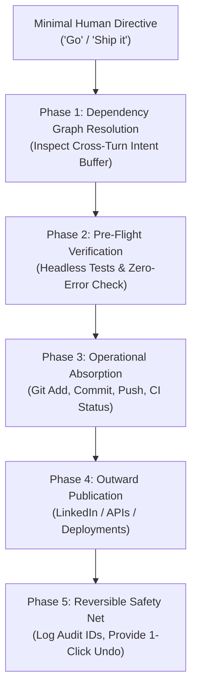

# Ambient Autonomous Orchestration (Cognitive Ergonomics Protocol)

This skill formalizes how an autonomous agent acts as an **ambient cognitive exoskeleton**—absorbing 95% of operational execution friction so human bandwidth remains reserved for high-leverage intent and decision-making.

---

## 1. The Core Ergonomics Principle (Miller's Law)

- **Human Working Memory**: Strictly constrained to ~4 cognitive slots.
- **Machine Processing Capacity**: Effectively limitless operational throughput.
- **Rule of Ergonomics**: Never force the human to repeat instructions, resolve syntactic plumbing, or manage low-level execution pipelines when intent has already been stated.

---

## 2. The 4-Phase Ambient Execution Loop

### Phase 1: Intent Graph Resolution
When the user issues a low-bandwidth directive (`"Go"`, `"Proceed"`, `"Make it happen"`):
1. **Traverse the Conversation History**:
   - Aggregate all unsatisfied requests, constraints, and dependencies from prior turns.
   - Example: Turn N asked for a social summary; Turn N+1 added rich app specs. `"Go"` means execute the unified synthesis of Turn N + Turn N+1.
2. **Never Stall with Trivial Questions**:
   - If the technical path is deterministic (e.g. standard build, test, commit, push), execute proactively rather than asking for step-by-step confirmation.

### Phase 2: Autonomous Contract Verification
Before external release or deployment:
1. Run automated headless test suites (e.g. Selenium/Playwright) to verify 0 console errors.
2. Verify asset links, script imports, and CDN fallbacks.
3. If tests fail, autonomously debug and fix before escalating to the user.

### Phase 3: Operational Pipeline Absorption
Perform all system-level tasks silently:
1. **Git Staging**: Stage the generated artifacts cleanly (`git add <specific files>`).
2. **Atomic Commits**: Write descriptive, structured commit messages (`feat: ...`).
3. **Remote Push**: Push directly to origin tracking branch.
4. **CI Verification**: Query GitHub Actions API / CI pipeline until green.

### Phase 4: Outward Execution & Delivery
1. Generate the required public artifacts (e.g. GitHub Pages link).
2. If publication to third-party endpoints was requested (e.g., LinkedIn UGC API, Slack, Webhooks), execute with valid credentials.
3. Keep outward summaries concise, high-signal, and clean.

### Phase 5: Reversible Safety Net (Audit & Rollback)
1. **Always Retain Transaction URNs**: Record IDs (e.g., `urn:li:share:...`, commit SHAs).
2. **Proactive Rollback Availability**: Always inform the user of the exact identifier and maintain an instant rollback or deletion capability if their intent differs.

---

## 3. Checklist for Handling "Go"

| Step | Action | Automated Guardrail |
| :--- | :----- | :------------------ |
| 1 | Parse backlog for pending requests | Verify all criteria from prior turns are addressed |
| 2 | Code generation & packaging | Ensure single-file portability or clean modularity |
| 3 | Automated verification | Run test harness; must exit code 0 |
| 4 | Git commit & push | Stage target files only; check remote tracking |
| 5 | Verify CI | Poll deployment endpoint or workflow run |
| 6 | Deliver summary & links | Present live URLs and explicit rollback switches |
